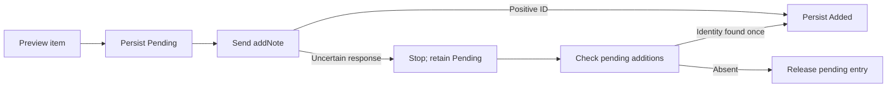

# AnkiConnect integration

This guide describes the implemented new-note workflow. [The user's guide](USER-GUIDE.md#create-missing-vocabulary-notes)
explains its controls. Statistics importing does not use AnkiConnect.

## Components and transport

[MainWindow.Creation.cs](../src/AnkiStats.App/MainWindow.Creation.cs) handles input,
preview, explicit confirmation, progress, and persistence. [NoteCreation.cs](../src/AnkiStats.Core/NoteCreation.cs)
selects candidates, builds payloads, creates notes, and reconciles uncertain
attempts. [AnkiConnectClient.cs](../src/AnkiStats.Core/AnkiConnectClient.cs) implements
HTTP and profile/model/deck/inventory verification. The separately installed
AnkiConnect add-on is not bundled or copied into this repository.

The client posts JSON with action, version 6, params, and optional key to the fixed
endpoint `http://127.0.0.1:8765/`. Proxy use and redirects are disabled; each request
has a 90-second timeout. The optional key stays in memory. This native client
does not use browser CORS or send collection content to an internet service.

UTF-8 JSON is buffered into StringContent before sending so Content-Length is
known. The installed add-on rejected chunked PostAsJsonAsync requests with HTTP
400; buffering fixed that incompatibility. Responses must contain result/error.
API errors, HTTP rejection, timeout, and unreachable-service failures are reported
separately. There are no automatic request retries.

## API actions

| Action | Role |
| --- | --- |
| version | Require API 6 or later |
| getActiveProfile | Match the running profile to the imported folder's basename |
| modelNamesAndIds | Verify the Japanese model ID matches imported metadata |
| deckNames | Require 日本語::勉強してる |
| modelFieldNames | Require Front/English and retain all field names |
| findNotes, query empty | Enumerate the running collection's notes across all decks |
| notesInfo, batches of 500 | Read current model names, fields, and tags |
| canAddNotes | Validate each candidate with Anki's duplicate protection |
| addNote | Add one explicitly confirmed note |

No sync, scheduling, existing-note editing, or tag-editing actions are called.
Checks reduce stale-preview risks; they do not lock Anki against every concurrent
edit. The app rereads inventory before creation and skips/rejects detected changes.

## Prepare and preview

The UI requires a real session, successful import, current collection/settings
signature, and reference data. Japanese must map Front as expression and English
as meaning. Old reference bundles lacking preferred forms are upgraded from the
pinned public snapshot. Isolated/synthetic sessions cannot create notes.

ReadInventory verifies profile/model/deck, reads batches, checks response sizes,
and checks the profile again. LiveExclusions extracts note types mapped as
Vocabulary using imported field metadata, runs dictionary matching, and excludes
confirmed entries, possible candidates, and recorded generated identities across
all decks. Unmapped types do not become semantic matches; Anki's own validation
adds a further duplicate check.

Candidates also excludes cached confirmed/possible matches and Pending/Added
journal IDs. It shuffles within N5, N4, N3, N2, N1, then Common, deduplicates IDs
across lists, and requires a usable preferred form/gloss. Generated Front text is
checked by the vocabulary parser. Prepare deduplicates identical Front strings
and calls canAddNotes until it reaches the requested count or runs out.

Preview shows concrete Front/English fields and any shortage before Create.
Cancel never adds notes. Zero eligible entries produces an exhaustion error.

## Payload and write sequence

The fixed Japanese model and 日本語::勉強してる deck are used. Every field starts
empty. HTML-encoded Front and English glosses are filled; English also receives a
hidden JMdict attribution/license/entry-ID comment. Tags is an empty array.
allowDuplicate is false and duplicateScope is collection. Existing templates
generate cards; no daily limits or schedules are adjusted.

Creation rereads inventory and verifies the field list still matches preview.
For each eligible note it checks the profile and canAddNotes again, persists
Pending, sends addNote, and persists Added with the returned ID. Requests are
sequential. The UI blocks repeated submission while sending. An error stops
further writes; successfully added notes remain and no rollback is claimed.

## Recovery and matching identity

The creation records in coverage_decisions store entry ID, state, optional note
ID, and matching fingerprint. Pending and Added entries stay excluded across
restarts. Acknowledged IDs are not automatically released if notes are later deleted.

Reconcile reads live inventory and searches the existing English attribution
comment for dictionary identity. Legacy ankistats::jmdict::<ID> tags are readable,
but new notes have no tags. Exactly one result becomes Added; none releases the
attempt; multiple results require inspection. This check never creates/deletes
notes. Removing old tags is supported because older generated notes also have
attribution comments. Removing both identity sources before reconciliation
weakens recovery; uncertain notes then need manual inspection.

SaveGeneratedMatches creates app-owned MatchDecision records with Origin Generated
without overwriting existing decisions. Fingerprints bind identity to expression,
readings, and normalized definition. Refresh recovers acknowledged identities
from the journal if the app closed before separately saving them. Later target
edits can make a decision stale. Creation itself does not replace the cached
import: the user closes Anki and refreshes afterward.

## Validation

[NoteCreationChecks.cs](../tests/AnkiStats.Checks/NoteCreationChecks.cs) simulates
selection, spillover, exhaustion, payloads, profile changes, stale previews,
pre-write journal failure, lost responses, and tag-free recovery.
[AnkiTransportChecks.cs](../tests/AnkiStats.Checks/AnkiTransportChecks.cs) exercises
wire framing against a temporary loopback HTTP listener and checks HTTP rejection
diagnostics. These checks do not add real notes.
