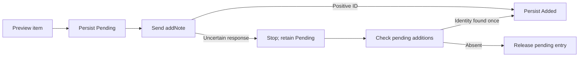

# AnkiConnect integration

This guide describes live importing and the new-note workflow. [The user's guide](USER-GUIDE.md#create-missing-vocabulary-notes)
explains the controls. AnkiConnect is used when the running Anki holds an exclusive
database lock, for note creation, and for explicitly confirmed expression/reading
corrections. Closed-file imports and cached analysis work without it.

## Live importing

[CollectionReader.cs](../src/AnkiStats.Core/CollectionReader.cs) first attempts a
read-only file snapshot. If the source is unavailable, it uses
[LiveCollectionImporter.cs](../src/AnkiStats.Core/LiveCollectionImporter.cs) to read
through AnkiConnect. Isolated and synthetic UI sessions never fall back to the
user's running Anki. Inspection, settings preview/save, manual refresh, and
automatic refresh after creation use this file-first path. Startup attempts only
a live incremental read and keeps the saved results when that is unavailable.

The live reader verifies API version and active profile before and after reads.
It reads deck/model IDs and ordered field names, searches exact `did:` membership,
and uses `getDecks` when a filtered card appears in both its current and home deck.
Cards stay assigned to their home decks, preserving import scope and counts.
Selective `cardsInfo` fields avoid unnecessary card rendering where supported.
Older add-ons that reject that parameter use the standard response, which is read
as data and never executed.

### Refresh modes

**Full Refresh** fetches current card details and note fields, then reads and
verifies all available review history for cards in the saved mapped scopes. It
replaces the live change index and the projected statistics together in local
SQLite. The **Fast Refresh** button can also build a full baseline when the
index is missing, settings or note types changed, or more than 28 days passed
since the last live read. With Anki closed, clicking either button reads a
complete private file snapshot.

**Fast Refresh** uses AnkiConnect's current deck membership, card and note
modification times, and buried-card search to decide which details to fetch.
Timestamps have second resolution, so it rereads rows near the last read boundary.
It checks histories for changed or newly included cards, cards from Anki's recent
answer search, and cards with cached reviews from the previous read's overlap
window. This last group catches recent reviews removed by undo. The search covers
the time since the previous read plus two Anki study days of overlap. Each fetched
history replaces the prior history for its card. Older review-only edits or
syncs can require **Full Refresh**.

Metadata, membership, modification times, and the fetched histories are checked again
before acceptance. Detected changes reject the import and retain the prior cache;
these checks are not a transaction spanning all HTTP requests. Live and file
imports share mapping validation and text extraction. When Media is in use it
gets all-deck notes and cards from the same read without a second history pass.
Manual Media comparison reads vocabulary only. Source schema version is unknown
(metadata value 0) through the API.

AnkiConnect cannot enumerate orphaned review rows whose cards were deleted. Live
imports explicitly mark that count unavailable; ordinary card review history is
not truncated. The flag and import method survive caching and profile selection.
No sync, export, deck creation, repair, or scheduling actions are used for imports.
The optional API key is entered in Settings and stays in memory for the session.

## Components and transport

[MainWindow.Creation.cs](../src/AnkiStats.App/MainWindow.Creation.cs) handles input,
preview, explicit confirmation, progress, and persistence. [NoteCreation.cs](../src/AnkiStats.Core/NoteCreation.cs)
selects candidates, builds payloads, creates notes, and reconciles uncertain
attempts. [AnkiConnectClient.cs](../src/AnkiStats.Core/AnkiConnectClient.cs) implements
HTTP and profile/model/deck/inventory verification. The separately installed
AnkiConnect add-on is not bundled or copied into this repository.

The client posts JSON with action, version 6, params, and optional key to the fixed
endpoint `http://127.0.0.1:8765/`. Proxy use and redirects are disabled; each request
has a 90-second timeout. The optional key stays in memory. This native client
does not use browser CORS or send collection content to an internet service.

UTF-8 JSON is buffered into StringContent before sending so Content-Length is
known. The installed add-on rejected chunked PostAsJsonAsync requests with HTTP
400; buffering fixed that incompatibility. Responses must contain result/error.
API errors, HTTP rejection, timeout, and unreachable-service failures are reported
separately. There are no automatic request retries.

## API actions

| Action | Role |
| --- | --- |
| version | Require API 6 or later |
| getActiveProfile | Match the running profile to the imported folder's basename |
| modelNamesAndIds | Verify the Japanese model ID matches imported metadata |
| deckNamesAndIds | Enumerate stable deck IDs for live imports |
| findCards, exact did:, rated:, is:buried | Enumerate deck membership and identify recent reviews and bury state |
| getDecks | Read current physical membership to resolve filtered cards' home decks |
| cardsInfo, batches of 200 | Read current card IDs, note IDs, queue, type, lapses and modification time |
| getReviewsOfCards, batches of 200 | Read and verify histories for the cards refreshed in this pass |
| cardsModTime, notesModTime | Compare to cached stamps and detect edits during a live import |
| deckNames | Require 日本語::勉強してる |
| modelFieldNames | Require Front/English and retain all field names |
| findNotes, query empty | Enumerate the running collection's notes across all decks |
| notesInfo, batches of 500 | Read current model names, fields, and tags |
| canAddNotes | Validate each candidate with Anki's duplicate protection |
| addNote | Add one explicitly confirmed note |
| updateNoteFields | Apply or undo a displayed existing-note expression/reading correction only |

No sync, scheduling or tag-editing actions are called. Existing-note field edits
are confined to the explicit Mappings correction flow.
Checks reduce stale-preview risks; they do not lock Anki against every concurrent
edit. The app rereads inventory before creation and skips/rejects detected changes.

## Prepare and preview

The UI requires a real session, successful import, current collection/settings
signature, and reference data. Japanese must map Front as expression and English
as meaning. Old reference bundles lacking preferred forms are upgraded from the
pinned public snapshot. Isolated/synthetic sessions cannot create notes.

ReadInventory verifies profile/model/deck, reads batches, checks response sizes,
and checks the profile again. LiveExclusions extracts note types mapped as
Vocabulary using imported field metadata, runs dictionary matching, and excludes
confirmed entries, possible candidates, and recorded generated identities across
all decks. Unmapped types do not become semantic matches; Anki's own validation
adds a further duplicate check.

Candidates also excludes cached confirmed/possible matches and Pending/Added
journal IDs. It shuffles within N5, N4, N3, N2, N1, then Common, deduplicates IDs
across lists, and requires a usable preferred form/gloss. Generated Front text is
checked by the vocabulary parser. Prepare deduplicates identical Front strings
and calls canAddNotes until it reaches the requested count or runs out.

Preview shows concrete Front/English fields and any shortage before Create.
Cancel never adds notes. Zero eligible entries produces an exhaustion error.

## Payload and write sequence

The fixed Japanese model and 日本語::勉強してる deck are used. Every field starts
empty. HTML-encoded Front and English glosses are filled; English also receives a
hidden JMdict attribution/license/entry-ID comment. Tags is an empty array.
Media Import reuses this writer with a ranked Completed-media candidate list,
including entries outside Common/JLPT. Available local-script sentences and source
titles are HTML-encoded into Sentence/Media when those fields exist. The preview
shows blank sentences explicitly; reference-list batches retain blank extra fields.
allowDuplicate is false and duplicateScope is collection. Existing templates
generate cards; no daily limits or schedules are adjusted.

Creation rereads inventory and verifies the field list still matches preview.
For each eligible note it checks the profile and canAddNotes again, persists
Pending, sends addNote, and persists Added with the returned ID. Requests are
sequential. The UI blocks repeated submission while sending. An error stops
further writes; successfully added notes remain and no rollback is claimed.

## Recovery and matching identity

The creation records in coverage_decisions store entry ID, state, optional note
ID, and matching fingerprint. Pending and Added entries stay excluded across
restarts. Acknowledged IDs are not automatically released if notes are later deleted.

Reconcile reads live inventory and searches the existing English attribution
comment for dictionary identity. Legacy ankistats::jmdict::<ID> tags are readable,
but new notes have no tags. Exactly one result becomes Added; none releases the
attempt; multiple results require inspection. This check never creates/deletes
notes. Removing old tags is supported because older generated notes also have
attribution comments. Removing both identity sources before reconciliation
weakens recovery; uncertain notes then need manual inspection.

SaveGeneratedMatches creates app-owned MatchDecision records with Origin Generated
without overwriting existing decisions. Fingerprints bind identity to expression,
readings, and normalized definition. Refresh recovers acknowledged identities
from the journal if the app closed before separately saving them. Later target
edits can make a decision stale. After a completed or partial creation batch,
the UI automatically imports a fresh snapshot with Anki still open. If that
refresh fails, it retains the creation result and reports how to retry Fast Refresh;
successful notes remain in Anki. File imports do not require AnkiConnect.

## Confirmed grammar links

Confirmed per-note grammar links from [Mappings](mappings.md) are included in live
duplicate checks across configured vocabulary and grammar note types. Current
fields must still match the saved fingerprint. Mapping review itself writes only
app-owned local decisions unless its displayed Anki correction checkbox is enabled.

## Existing-note corrections

`AnkiNoteCorrection.cs` prepares mapped expression/reading changes against the
current note and model schema, checks profile and 日本語 membership, guards raw
field values, and calls `updateNoteFields` once. The exact payload changes only
those fields; user meanings, sentence/media fields and tags are not replaced.
The operation uses the existing note ID and does not invoke card/scheduling APIs.
Simple formatting and sound markers survive targeted text replacement; ambiguous
fragmented markup is rejected. All sibling cards use the edited note fields.

The [AnkiConnect API documentation](https://github.com/FooSoft/anki-connect/blob/5b6fe5766c0e1ee476c78a9de1c085b37d817cd7/README.md#updatenotefields)
describes field updates and notes an editor-related no-op case. A fresh `notesInfo`
read verifies the intended values rather than trusting an error-free response.
Lost acknowledgements are read back without automatically repeating the write.
Receipts persist before sending; uncertain results remain Pending verification.
The dashboard's status check is read-only. Popup Undo applies an inverse receipt
only if the note's guarded fields still match. Isolated/synthetic UI sessions
cannot reach the live edit path. See [Mappings](mappings.md) for controls and
the distinction between local link buckets and actual field-edit receipts.

## Validation

[NoteCreationChecks.cs](../tests/AnkiStats.Checks/NoteCreationChecks.cs) simulates
selection, spillover, exhaustion, payloads, profile changes, stale previews,
pre-write journal failure, lost responses, and tag-free recovery.
[AnkiTransportChecks.cs](../tests/AnkiStats.Checks/AnkiTransportChecks.cs) exercises
wire framing against a temporary loopback HTTP listener and checks HTTP rejection
diagnostics. These checks do not add real notes.
[LiveImportChecks.cs](../tests/AnkiStats.Checks/LiveImportChecks.cs) covers live
mapping/extraction, home-deck membership, changed records, cache provenance,
exclusive-lock fallback, wrong-profile rejection, and isolated-session protection.
It verifies that startup reuses a compatible live cache and skips a full import
when AnkiConnect is offline or the cache is missing, stale, or incompatible.
[FastRefreshChecks.cs](../tests/AnkiStats.Checks/FastRefreshChecks.cs) covers recent
review undo, deck moves, cache persistence, and parity with a full rebuild. Its
16,000-card scenario measures simulated AnkiConnect response sizes and importer
timing for unchanged data and 2,000 changed cards.
The check runner's `--inspect-live <profile-folder>` command performs read-only
discovery and a full live import without saving settings or creating notes.
