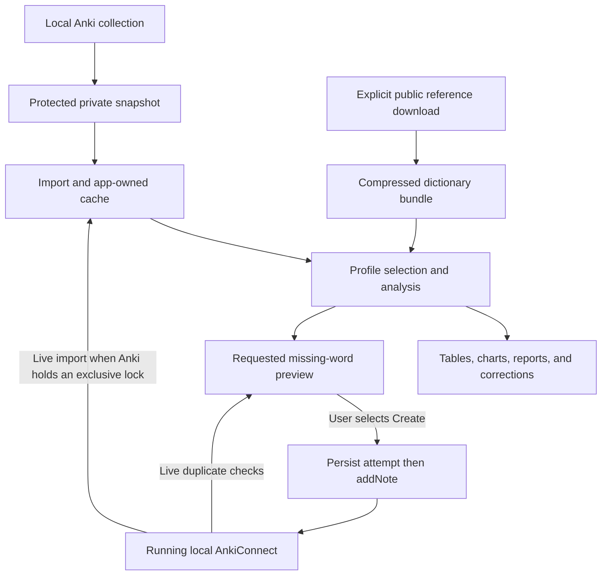

# Anki Stats: how the program works

For installation and everyday use, start with the [user's guide](USER-GUIDE.md).
This guide explains the implementation in plain language, with code links. The
[dictionary guide](dictionary-and-coverage.md) and [AnkiConnect guide](anki-connect.md)
describe those subsystems in more depth. [DESIGN.md](DESIGN.md) is the current
behavior specification; [future plans](FUTURE-PLANS.md) are not implemented yet.

Anki Stats is a Windows desktop app that helps you explore the Japanese vocabulary and review history in a local Anki collection. It answers questions such as: how many different vocabulary entries are in the decks you selected, when you tend to review, which cards receive the most reviews, and which cards receive the most Again answers.

The app measures collection inventory, recorded study activity, and local
dictionary coverage. Word Coverage adds common-word and corrected OpenJLPT N5–N1
statistics, missing-word reports, match corrections, and conservative stem-family
grouping. Grammar-pattern analysis and media recommendations remain future work.

## A few Anki terms

| Term | Meaning |
| --- | --- |
| Profile | The local folder containing an Anki user's collection and related files. |
| Deck profile | An app-specific named deck selection, such as 日本語, 漢字, or 日本語 + 漢字. These all read the same connected Anki collection. |
| Collection | The database containing notes, cards, decks, and review history. The main file is `collection.anki2`. |
| Note | Stored information, such as a word and its meaning. |
| Card | A question generated from a note. A note can generate more than one card. |
| Note type | The definition of a note's fields and card templates. |
| Review event | A recorded answer. Answering the same card repeatedly creates multiple events. |
| Field mapping | Your choice of which note fields contain the expression, reading, and meaning. |

These distinctions matter. Ten notes do not necessarily mean ten different words, and ten thousand answers do not mean ten thousand different cards.

## Connect your collection

1. Anki may be open or closed. Keep AnkiConnect enabled for live access while Anki is open.
2. Open the published `AnkiStats.exe` or its shortcut.
3. In Settings, choose **Browse…** and select the profile folder containing `collection.anki2`.
4. Select **Inspect profile** to load the available decks and note types.
5. Include the deck tree you want to analyze. Descendants inherit a parent's rule. An explicit exclusion omits a subtree; unrelated decks remain excluded.
6. Assign note-type categories and confirm their fields. Vocabulary contributes inventory and reviews. Grammar and Kanji contribute reviews without becoming vocabulary entries. Ignored types contribute neither.
7. Check the review time zone.
8. Choose **Preview selection**. Inspect the counts and example expressions. If fields contain bracket readings such as 漢字[かんじ], use the explicit bracket-reading option when appropriate; it removes annotations from the expression and does not create a separate reading field.
9. Choose **Save and refresh**.

The app remembers this configuration. Later launches refresh automatically. A refresh reads what is already present in the local collection; it does not synchronize AnkiWeb or pull reviews directly from another device.

## Read the overview

**Vocabulary entries** counts distinct normalized expression/reading pairs in mapped vocabulary notes. Repeated notes with the same pair count once, even when they generate several cards. New, learning, review, suspended, and buried cards are included by default within the chosen scope.

This is an inventory count, not a claim that every entry is mastered. 報う,
報いる, and 報われる remain three entries; Word Coverage groups them as one
explicitly curated stem family without collapsing their dictionary identities.

**Total review answers** includes rated learning, ordinary review, relearning, and filtered/cram events. The breakdown explains how the total was formed. Manual scheduling operations and other administrative records are excluded. Ordinary reviews alone are a smaller subset, so comparing that subset with Anki's overall answer total would be misleading.

**Again rate** on the overview uses ordinary review answers only. It is the number rated Again divided by the number of eligible ordinary review answers. It is not a general fluency or comprehension score.

**Today's discovery** shows one observation, with its calculation and scope on the card. For example, consistency states how many dates had answers, the number of dates between the first and last answer, and the resulting percentage. Calendar dates run from midnight to midnight in the displayed time zone. Anki can use a different study-day boundary, so day counts and streaks may differ even when answer totals agree.

The discovery topic stays the same for a day while refreshed values can change. A template cannot repeat within seven calendar days. Collections with too little data may show an explanation instead of a new observation.

Always check the source profile, included deck rules, and last successful refresh time. A test-session banner identifies isolated development data; those numbers must not be interpreted as your collection's statistics.

## Inspect common-word and JLPT coverage

Open **Word Coverage**, download the reference data once, then use it offline.
**Known** means supported by vocabulary cards in 永遠; **Familiar** means cards
in 勉強してる. **Combined** counts their union once. Suspended-deck vocabulary
contributes only to **In database**, which includes the active imported selection
rather than excluded decks. Raw card/note totals are separate from dictionary-entry
coverage. Ambiguous and unmatched notes receive no coverage credit.

Every reference row shows a numerator, denominator, and percentage. N5–N1 are
independent lists; Through N3 combines N5, N4, and N3 without duplicating entries.
The app uses corrected OpenJLPT memberships, so live Jisho tags can differ.
Source versions and excluded unlinked rows are disclosed.

Select a list and export a Markdown report to see words outside Known/Familiar,
or words with no confirmed match anywhere in the imported database. Reports show
word, reading, meaning, dictionary ID, and database status. A word may appear
missing because its Anki note needs matching review; these possible matches now
have their own report section.

Matching prefers the exact written script and resolves explicitly listed readings
independently. A note with two dictionary readings can support two entries, while
two readings of one entry still count once. A small, uniquely identifiable reading
discrepancy on an exact kanji spelling counts with a visible **Reading warning**
and remains in **Needs review**. Larger discrepancies and ambiguous homographs
remain unresolved; **Partial** matches count only their confirmed alternatives.

The English meaning helps distinguish compatible homophones: `はい` with “yes”
matches the yes entry. Tied or unsupported definitions cannot resolve ambiguity.
Different wording on a unique Japanese match produces a **Definition warning**
for review. Any one accepted spelling or reading is sufficient; you do not need
all variants or all meanings. Reports show a kana lookup first and label the
remaining forms as optional alternatives.

Use **Review selected match** to resolve candidates, enter a verified dictionary
ID (or comma-separated IDs for explicitly studied alternatives), exclude a note,
or reset a correction. The first save previews the entries; the
next confirms it. Decisions survive imports but require review when the target
expression/reading or English definition changes, or a saved dictionary ID
disappears. Older fingerprints remain readable. Match correction leaves Anki unchanged.
Optional shared family labels group related dictionary entries conservatively;
the displayed rules explain the limited initial automatic grouping. See the
[README's Word Coverage section](../README.md#word-coverage) for details.

## Explore details and export data

**Learning Patterns** has three views: Difficulty candidates, Cross-deck comparison, and Shared patterns. The card list follows the active profile and can be filtered to three historical lapses, active cards, recovery/suspended cards, recent recurrence, or unresolved character readings. Shared groups also follow the active profile. Cross-deck comparisons deliberately use both imported 日本語 and 漢字 trees; known vocabulary is supporting context and never a difficulty ranking. Select a finding to see its explanation and cards; double-click a card for IDs and ordinary review history. A repeated word or reading is a possible connection to inspect, not proof of confusion. The page's expandable measurement guide explains the deck exclusions, recovery roles, and unresolved readings. No dictionary or grammar inference is performed.

**Time Analysis** shows recorded review hours, daily/weekly time charts, mean and median seconds per answer, and weekday/hour breakdowns for the active deck profile. Its Last 6 months filter uses six calendar months rather than a fixed 180 days. The comparison table always shows all-history and six-month results alongside one another, regardless of the selected chart range. Gray and gold chart lines mark the corresponding average daily or seven-day time. Exact period totals are available below the breakdowns. Calendar averages include zero-review dates; the first available answer limits how far back those averages extend. Today and edge weeks may be incomplete. Time uses the same 4 AM study-day cutoff as Calendar. Anki can cap recorded answer durations, and missing durations cannot be reconstructed, so the hours card measures recorded answer time rather than all elapsed study time.

Use **Active profile** in the header to choose the named deck selection for all summary cards, detail pages, discoveries, and exports. Overview keeps a separate Review rhythm chart for every enabled deck profile. Calendar has a synchronized profile selector and remembers the chosen streak range per profile while the app is open. A combined profile adds answers from both decks, and either deck can keep its streak active.

Manage deck profiles in Settings: select a profile row, edit its include/exclude rules below, and preview and save. Names and enabled states can be edited in the table; Add profile copies the selected rules as a starting point. Turning a profile off removes its chart and active-selection option. Switching between saved profiles uses cached data; Refresh is only needed to obtain new Anki activity. Field mappings and time zone apply to all profiles.

In **Vocabulary**, search by expression, reading, meaning, or deck. Click column headings to sort. Double-click an entry to inspect its supporting note and card IDs. The skipped-expression view identifies mapped vocabulary notes whose extracted expression is empty. Export CSV saves the current search results and sort order.

In **Reviews**, select a date range and event kind. The default event filter is ordinary review; choose all rated answers when comparing with the overview's total. The chart can display daily or weekly volume. Time-of-day rows show answer counts, Again rates, and median recorded answer durations. A median is the middle duration after sorting, which reduces the influence of unusually long answers. Zero or missing durations are excluded from timing calculations.

Small samples are labeled as limited data. Response durations may be capped by Anki, and differences between time buckets can reflect card difficulty or workload. They do not establish that studying at a particular hour causes better memory.

Card rankings always use ordinary reviews in the chosen date range. The Again count is separate from the current card's lifetime lapse counter. The review CSV identifies daily rows, time buckets, and rankings so their meanings remain distinguishable.

## How the program was written

The program is written in C# on .NET 10. WPF supplies the Windows interface, XAML describes its layout and styling, and SQLite supplies database access. The code is divided into a desktop project, a core library, and an executable check runner. The desktop project references the core library, so calculations can also run without opening a window. Charts are drawn directly in WPF; there is no web frontend, runtime AI service, or chart-library server.

### Three separate data paths



The snapshot importer reads recorded history and vocabulary. The reference
installer downloads public dictionary/classification files. The optional writer
talks to the running Anki application only after explicit confirmation. Keeping
these paths separate lets stats remain offline/read-only while providing a
narrowly scoped new-note feature.

### From a button click to a screen update

[MainWindow.xaml](../src/AnkiStats.App/MainWindow.xaml) defines the pages, buttons, tables, and named text controls. Its companion file, [MainWindow.xaml.cs](../src/AnkiStats.App/MainWindow.xaml.cs), contains event handlers: methods WPF calls when something happens in the window.

For example, the Refresh button calls `RefreshClick`, which runs `RefreshInternal` through a shared `Guard` method. `Guard` disables conflicting controls, shows progress, catches errors, and restores the controls afterward. Startup follows the same refresh path after loading settings and any cached import. Without saved settings, it opens the setup page.

The window uses **code-behind**, meaning its event-handling C# lives alongside its XAML. Table columns use **data binding**: a column names a property such as `Expression`, and WPF displays that property for each row object. Other controls are updated explicitly, for example:

```csharp
ReviewCount.Text = overview.TotalAnswers.ToString("N0");
```

Here, `overview` holds calculated results, `ReviewCount` is a named text control, and `N0` formats an integer with thousands separators.

### Reading and selecting Anki data

[CollectionImporter.cs](../src/AnkiStats.Core/CollectionImporter.cs) handles collection access. Its `WithPrivateCopy` method acquires a read-only file handle, checks for active journals, copies the collection to a temporary file, and opens SQLite against that copy. A `finally` block attempts to remove the temporary database and its sidecar files whether reading succeeds or fails.

`ReadMetadata` first checks the schema version. Schema 11 stores deck and note-type definitions as JSON; schema 18 uses separate tables. The importer translates both layouts into the same C# data types, so the analysis code does not need a separate implementation for each schema.

`Import` then reads the `cards`, `notes`, and `revlog` tables. Their IDs connect the records: a card refers to a note, and a review event refers to a card. The code uses dictionaries and hash sets to look up selected IDs efficiently rather than repeatedly searching every record.

Deck rules and field mappings determine what survives that selection. A parent deck rule applies to descendants unless a more specific rule overrides it. Ignored note types are omitted. For included notes, the importer splits Anki's stored field string and extracts the mapped expression, reading, and meaning. [Models.cs](../src/AnkiStats.Core/Models.cs) defines the resulting note, card, review, settings, and result objects.

### Turning records into statistics

[Analysis.cs](../src/AnkiStats.Core/Analysis.cs) contains three responsibilities: field-text cleanup, analysis, and CSV output.

`TextNormalizer.Clean` removes presentation markup and sound references, decodes HTML entities, and normalizes Unicode text. Removing bracket readings is an explicit mapping option. It does not use a dictionary or infer stem families.

`Analyzer.Analyze` groups vocabulary notes by expression and reading using LINQ, C#'s collection-query methods:

```csharp
.GroupBy(n => (n.Expression, n.Reading))
```

Each group becomes one vocabulary row. The row retains supporting note/card IDs, so the displayed total can be inspected. Different expressions remain separate even if they share a stem.

For reviews, the analyzer excludes administrative events and invalid ratings, converts timestamps to the selected time zone, and applies the date range. It then separates the chosen answer kinds from the ordinary-review subset. Grouping by date produces daily totals; grouping by local hour produces the four time-of-day buckets. Answer durations are sorted to calculate medians. Card IDs connect ordinary-review counts and Again counts to the ranking rows.

The method returns an `AnalysisResult` containing vocabulary rows, daily totals, time buckets, rankings, and discovery candidates. The window assigns those rows to tables. [ReviewChart.cs](../src/AnkiStats.App/ReviewChart.cs) draws the volume chart with WPF rectangles, lines, and labels; weekly grouping happens before drawing.

### Profiles, Calendar, time, and learning patterns

[DeckProfiles.cs](../src/AnkiStats.Core/DeckProfiles.cs) validates and migrates named
deck selections. Import uses their union; Select filters the cached notes, cards,
and reviews for one profile. Stable profile IDs let names change without resetting
daily-discovery history. [MainWindow.Profiles.cs](../src/AnkiStats.App/MainWindow.Profiles.cs)
coordinates settings and active selection without another collection read.

[Streaks.cs](../src/AnkiStats.Core/Streaks.cs) applies the fixed 4 AM boundary and
builds consecutive active-day ranges. [StreakCalendar.cs](../src/AnkiStats.App/StreakCalendar.cs)
draws the heatmap as selectable daily cells on one drawing surface. Calendar uses
that boundary while the older review-volume and daily-discovery paths keep
midnight-based dates. This intentional difference explains some apparent totals
or streak discrepancies.

[TimeAnalysis.cs](../src/AnkiStats.Core/TimeAnalysis.cs) works with positive recorded
answer durations. It uses 64-bit millisecond sums, calendar-based range boundaries,
and zero-day-inclusive averages. [MainWindow.Time.cs](../src/AnkiStats.App/MainWindow.Time.cs)
connects ranges/tables and [TimeChart.cs](../src/AnkiStats.App/TimeChart.cs) draws
daily/weekly periods and comparison averages. It cannot recover time that Anki
did not record.

[LearningPatterns.cs](../src/AnkiStats.Core/LearningPatterns.cs) builds difficulty
and recovery cohorts from deck roles and ordinary-review Again history, then
compares explicit readings, written forms, and gloss evidence. It keeps current
lapse counters separate from reconstructed history. Cross-deck comparisons use
both imported Japanese/Kanji trees; active card/shared-pattern lists use their
stated profile scope. [MainWindow.Learning.cs](../src/AnkiStats.App/MainWindow.Learning.cs)
exposes filters and supporting evidence. These are deterministic associations,
not AI diagnoses, grammar parsing, or dictionary-driven compound-reading guesses.

### Dictionary matching and note creation

[CoverageReferenceStore.cs](../src/AnkiStats.Core/CoverageReferenceStore.cs) verifies
pinned public source checksums and builds a local compressed reference bundle.
[VocabularyExpression.cs](../src/AnkiStats.Core/VocabularyExpression.cs) extracts
intended forms/readings; [DefinitionMatcher.cs](../src/AnkiStats.Core/DefinitionMatcher.cs)
adds conservative English evidence; [VocabularyCoverage.cs](../src/AnkiStats.Core/VocabularyCoverage.cs)
resolves candidates, aggregates ID sets, groups limited stem families, and creates
Markdown reports. [MainWindow.Coverage.cs](../src/AnkiStats.App/MainWindow.Coverage.cs)
handles installation, filters, corrections, and profile-aware presentation.

Inventory counts normalized expression/reading pairs, whereas reference coverage
counts confirmed JMdict IDs. This lets kana/kanji variants count separately in
inventory if represented separately while supporting one reference entry. Ambiguous
alternatives remain reviewable; a sentence's incidental words receive no credit.
See [dictionary matching and coverage](dictionary-and-coverage.md) for the complete
source, restriction, warning, decision, and denominator flow.

[MainWindow.Creation.cs](../src/AnkiStats.App/MainWindow.Creation.cs) asks
[NoteCreation.cs](../src/AnkiStats.Core/NoteCreation.cs) for a random batch in the
fixed JLPT/Common order. It uses [AnkiConnectClient.cs](../src/AnkiStats.Core/AnkiConnectClient.cs)
to check live vocabulary across decks and validate the profile/model/fields.
Create sends one note at a time after recording a pending attempt. The hidden
attribution comment retains identity without Anki tags; the app-owned journal
handles uncertain responses. This path never writes source SQLite or updates
existing notes. See [AnkiConnect integration](anki-connect.md) for API actions,
HTTP framing, payloads, and crash recovery.

### Keeping the window responsive

Importing and analysis can take longer than a button click should block the interface. The window uses `Task.Run` to perform that work on a background thread and `await` to resume when it finishes:

```csharp
var next = await Task.Run(() =>
    new CollectionImporter(store.TemporaryRoot).Import(settings, progress));
```

While this runs, WPF can continue drawing the window and processing normal interface activity. The code computes the new results and saves the cache before replacing the window's current data. If importing fails, the error handler can keep showing the previous successful import.

### Saving results and choosing discoveries

[LocalStore.cs](../src/AnkiStats.Core/LocalStore.cs) maintains `analysis.sqlite` in
app data. Its tables separate the following responsibilities:

| Table | Stored content |
| --- | --- |
| settings | Serialized JSON for profile path, deck profiles/rules, mappings, and time zone |
| cache | Latest imported records as gzip-compressed JSON, including the import's own identity, settings signature, scope, and timestamp |
| insight_history | Daily template selections keyed by collection/profile scope |
| coverage_decisions | Per-collection JSON lists keyed by kind: matches, families, or creation journal |

The dictionary bundle lives separately under `reference/`, not in the cache table.
Loading the cache verifies collection identity. Identity is derived from the
normalized profile path; settings signatures hash the relevant configuration.
Changing a profile location therefore changes its collection identity rather
than silently claiming an unrelated cache belongs to it.

`SaveCache` uses a transaction: the database commits the new result as one operation. When a new connection is saved, its settings are written in that same transaction. This prevents a partially saved connection from becoming the stored result.

`SelectInsight` checks whether today's date already has a chosen template. If so, it returns that template with freshly calculated values. Otherwise, it removes templates used in the preceding seven dates, chooses from the remaining eligible candidates using the date, and saves the selection. This is date-based selection with persisted history, rather than an unrestricted random choice. A timer checks for a new local date while the app remains open.

### Exporting and checking behavior

`CsvExport` writes UTF-8 text with quoted cells, escaped quotation marks, and protection against formula-like cell contents. The window supplies the filtered vocabulary rows or the labeled review sections selected for export.

The separate [check runner](../tests/AnkiStats.Checks/Program.cs) builds synthetic collections, calls the core methods directly, and asserts expected results. It tests calculations and failure paths without requiring clicks in the GUI. These checks include duplicate handling, answer-kind separation, time boundaries, discovery rotation, cache behavior, locked sources, and unchanged source-file bytes.

Specialized checks cover Calendar, deck profiles, time analysis, learning patterns,
dictionary restrictions/definitions/reports, generated-note selection, and pending
recovery. An in-memory HTTP handler simulates AnkiConnect; a temporary loopback
server checks actual HTTP framing. Real note creation is not part of automated
tests. Marked synthetic fixtures support UI inspection with `ANKISTATS_DATA_DIR`;
normal builds must not be left running against those fixtures as the user's app.

### Building and packaging

The .NET SDK builds the App and Core projects. `scripts/publish.ps1` publishes a
self-contained win-x64 executable with runtime/native-library extraction support,
copies notices/licenses, and creates shortcuts. `scripts/launch.ps1` rebuilds the
current checkout before launching the canonical packaged output and clears
inherited test-data overrides. It records failures in `.tools/launch.log` rather
than silently opening an older build. Packaged executables remain snapshots;
there is no automatic application updater. See [tools used](tools-used.md).

For a file-by-file map, read [repository structure](repository-structure.md). For dependencies and build commands, read [tools used](tools-used.md).

## What happens to your data

The app copies an idle source under an exclusive read-only file handle, refusing active journals. SQLite queries run only against the private copy, never the original collection or its sidecars. The app does not bypass locks or repair, checkpoint, or write the source database. Temporary copies are removed after the operation.

Anki commonly holds an exclusive lock. In that case CollectionReader uses local
AnkiConnect to read notes, cards, and full review history, retaining home-deck
membership and checking for detected changes before accepting the result. These
API reads span multiple requests. Orphaned review rows cannot be counted through
AnkiConnect and are labeled unavailable. File imports and cached analysis remain
available without the add-on. The API key, if configured, is entered in Settings
and remains in memory for the session. See [live importing](anki-connect.md#live-importing).

Importing, analysis, and local link corrections do not modify Anki. Mappings can
explicitly correct an existing note's displayed expression/reading via AnkiConnect,
with current-field guards, durable receipts and read-back verification; see
[Mappings](mappings.md). Your meaning and other fields are preserved. The optional Word Coverage
creation panel adds new notes only after Preview and an explicit Create action.
It uses AnkiConnect with Anki open, checks the entire live collection for duplicates,
and always targets Japanese notes in 日本語::勉強してる. It never changes existing
notes or scheduling settings and never executes HTML or JavaScript from fields.
It has no telemetry. Reference installation downloads public data; live imports and creation talk
only to local AnkiConnect; cached analysis works offline. See the [creation instructions](../README.md#create-missing-vocabulary-notes)
for setup, preferred forms, selection order, and pending-attempt recovery.
Statistics and coverage refresh automatically after creation with Anki still open;
if refresh fails, created notes remain and the Refresh button retries the import.

Settings and imported data live in the per-user local application-data `AnkiStats` folder, available through **Open app data folder** in Settings. The cache holds the latest successful import; it is not a historical snapshot archive or a substitute for an Anki backup. CSV files go wherever you choose to save them.

## If the numbers look wrong

- Check the source profile and any test-session warning first.
- Confirm deck inclusion and exclusion rules, including inherited rules.
- Check categories and field mappings. An ignored type will not contribute, and a grammar type will not increase vocabulary inventory.
- Compare the same answer kinds, deck scope, date range, and time zone. Total answers and ordinary reviews are different measurements.
- Check the last successful refresh time. An error leaves previous results visible with their original scope and timestamp.
- Remember that history is attributed to a card's current home deck. Events for deleted cards without recoverable card metadata are excluded; file imports report collection-wide orphaned events, while live imports label that count unavailable.

If refresh fails, let Anki finish its current operation, verify the profile location, folder access and disk space, then retry with Anki still open. If Anki requires recovery, let it recover the collection first. Renamed or reordered mapped fields require inspecting the profile and previewing updated mappings. Unsupported collection schemas require an application update; do not change the database to make it fit.
